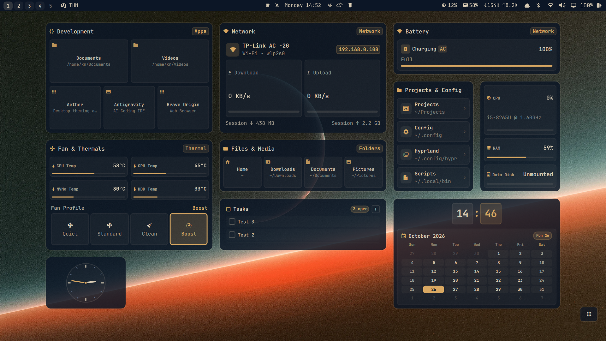
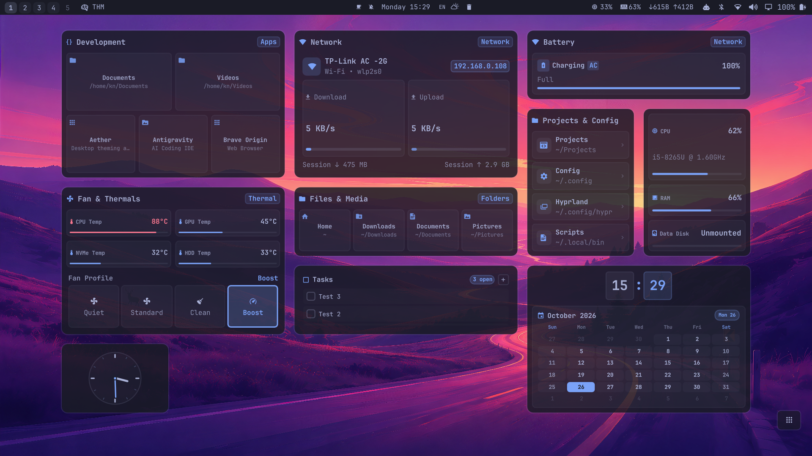
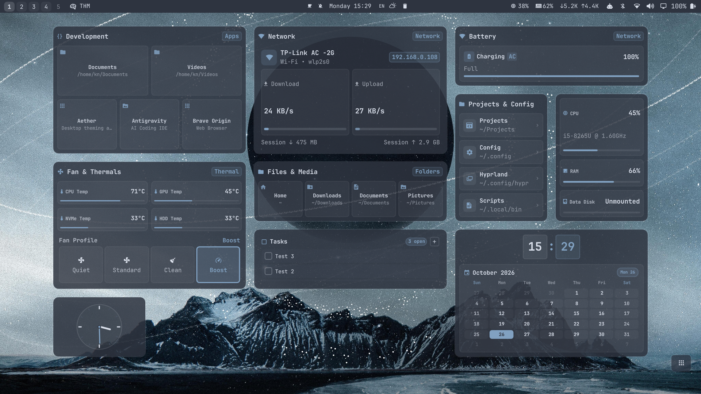
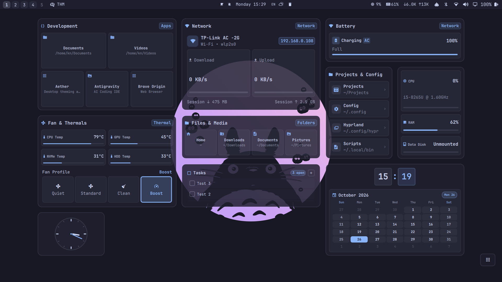
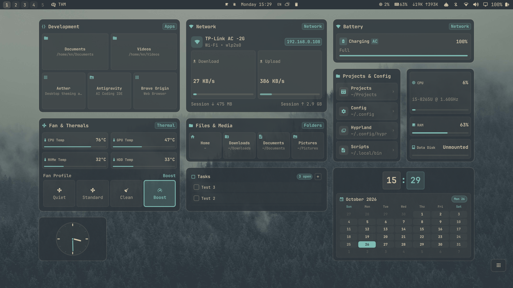
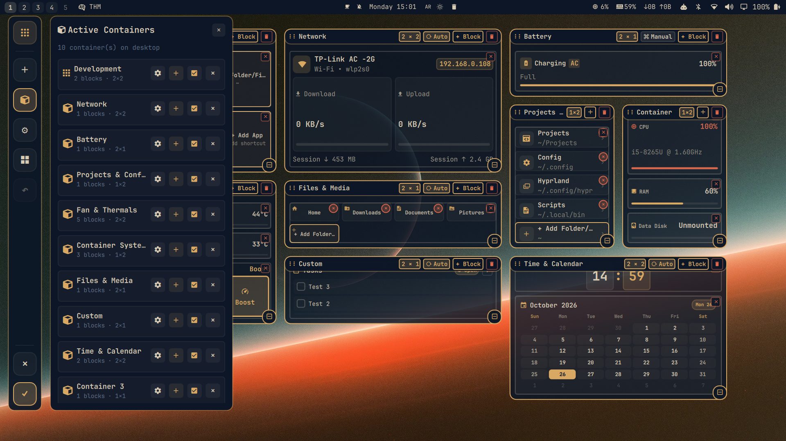
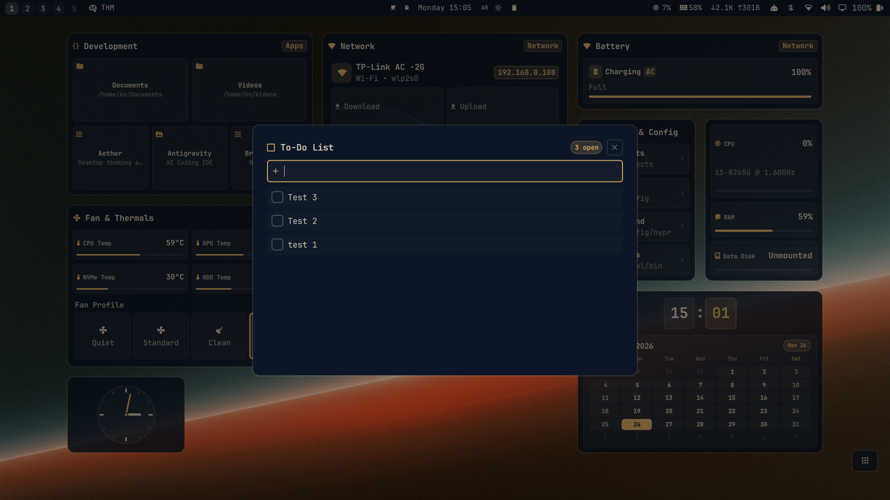
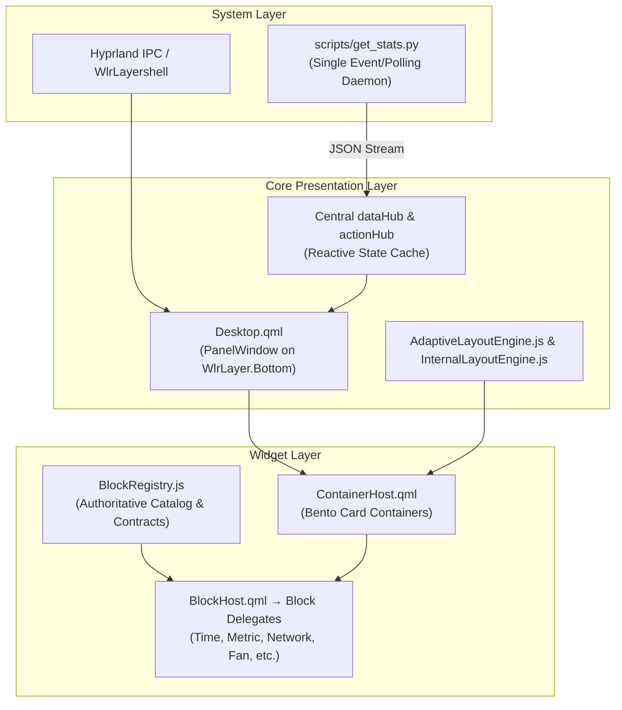

# 🖥️ ArchyWidgets — Theme-Aware Desktop Widgets & Bento Portals for Omarchy (Hyprland)

<p align="center">
  
</p>

**ArchyWidgets** is a lightweight, visually refined desktop dashboard and widget system built natively with **Quickshell (Qt6 / QML)** for **Omarchy** on **Hyprland / Wayland**.

It organizes your desktop background into elegant, semi-transparent **Bento-style Containers (Portals)** that react instantly to host theme changes, auto-pack into responsive 2D layouts, and remain bound exclusively to designated workspaces to keep the rest of your desktop clean and distraction-free.

---

## 🌟 Highlights

* 🎨 **100% Native Theme Reactivity:** Automatically binds to Omarchy's live `Commons.Color` and `Commons.Style` design tokens. Colors, borders, radii, and typography react immediately without application reloads.
* 🍱 **2D Bento Grid Engine:** Automatic reflow and collision-free packing engine supporting customizable container spans (`1×1`, `1×2`, `2×1`, `2×2`, `4×2`).
* 🔄 **Extensible Block Variants Architecture:** Multiple visual presentations for widgets (Analog, Minimal, Flip Cards, Digital, Tile, Gauge) sharing unified underlying logic without duplicating system timers or telemetry streams.
* ⚡ **Ultra-Low Idle Overhead:** Single centralized Python telemetry daemon (`scripts/get_stats.py`) feeds all blocks through a single shared data bus (`dataHub`), avoiding redundant subprocess spawning.
* 🛠️ **Interactive On-Canvas Studio & Edit Mode:**
  * **Direct Canvas Manipulation:** Drag handles, container resize grips, live block deletion, and auto/manual reflow toggles right on the desktop.
  * **Desktop Edit Sidebar & Settings:** Left vertical rail housing preconfigured container template catalog, active containers workbench, and global desktop settings (transparency, auto-hide, workspaces).
* 📌 **Workspace Pinning & Auto-Hide:** Locks widgets to specific Hyprland workspaces (default: Workspace 1) and optionally auto-hides when application windows are focused.
* 📝 **Global Floating To-Do Overlay:** Instant task checklist accessible from any workspace via global hotkey (`Super + Alt + L`).

---

## 📸 Omarchy Theme Gallery

ArchyWidgets never hardcodes palettes; it inherits the active Omarchy theme seamlessly. Every surface, font, border, and accent color updates the moment a theme is applied.

| **Tokyo Night (Neon Dark)** | **Nord (Arctic Blue)** |
|:---:|:---:|
|  |  |

| **Catppuccin (Pastel Violet)** | **Everforest (Nature Dark)** |
|:---:|:---:|
|  |  |

---

## 🎛️ Editing & Customization Experience

ArchyWidgets provides full graphical customization without needing to edit raw configuration files.

### Interactive Canvas Edit Mode & Unified Sidebar

Click the floating Customize button (󱗼) at the bottom-right or trigger via IPC (`openSettings` / `toggleEditMode`) to enter layout edit mode.

* **Direct Desktop Manipulation:** Drag containers across the Bento grid, resize container spans (`1×1`, `1×2`, `2×1`, `2×2`, `4×2`), adjust block variants with live previews, or toggle between **Auto Reflow** and **Manual Layout**.
* **Unified Sidebar (Left Rail):**
  * **Container Catalog:** Add preconfigured templates (Clocks, System Metrics, Apps, Folders, Hardware Thermals).
  * **Active Containers:** Reorder, rename, toggle visibility, and manage contained blocks.
  * **Desktop Settings:** Configure target Hyprland workspaces, window auto-hide behavior, and card background transparency presets (Glass 30%, Balanced 45%, Solid 65%, Opaque 85%).
* **Block Drawer (Right Rail):** Browse, configure, and assign widget blocks with instant live visual variant selection.

<p align="center">
  
</p>

---

## 🧩 Built-in Widgets & Capabilities

Every widget in ArchyWidgets is implemented as a lightweight QML presentation delegate adhering to a strict data-binding contract.

| Widget Category | Features & Information Displayed | Supported Variants / Options |
|---|---|---|
| **Hardware Thermals & Fan Profiles** | CPU, GPU, NVMe SSD, and secondary HDD package temperatures. Real-time thermal overview and one-click laptop fan profile switcher. | Modes: Quiet (`0`), Standard (`1`), Dust Clean (`2`), Fan Boost (`4`). Requires supported Linux ACPI/WMI drivers. |
| **Composable Clocks & Calendar** | Live time display with seconds, AM/PM indicators, and date. Integrated Gregorian and Hijri calendar with active day highlight and 7-day week strip. | Visual Variants: `DigitalClock`, `AnalogClock`, `FlipCards`, `MinimalClock`. |
| **System Metrics & Memory Cleaner** | Real-time CPU core usage, RAM usage, Swap space, Disk storage partition breakdown, Load Average, Uptime, Hostname, and Kernel version. | Visual Variants: `TileMetric`, `BarMetric`, `DashboardMetric`. Includes one-click RAM cache clean action. |
| **Network & Battery Telemetry** | Active Wi-Fi SSID / Ethernet interface, assigned IPv4 address, real-time download and upload speed gauges, session data transfer totals, AC power status, and battery percentage with Wattage rate. | Automatically hides battery indicators on systems running on AC without a physical battery. |
| **Quick Applications Grid** | Fast launcher shortcuts for terminal, web browsers, IDEs, file managers, and system utilities with responsive aspect-ratio icon tiles. | Supports tall list (`1×2`), square grid (`1×1`), and wide row arrangements. |
| **Pinned Folders Grid** | Instant one-click directory access to Projects, Configs, Downloads, Documents, or custom paths opening in your default file manager. | Automatically discovers system folders with customizable directory paths. |
| **Interactive Tasks & To-Do List** | Embedded checklist directly on the desktop dashboard plus a global floating popup overlay accessible from any workspace. | Add tasks, check-off toggles, inline item removal, and auto-focus text input. |

### Global Floating To-Do Overlay

In addition to the desktop dashboard block, ArchyWidgets features a centered floating task checklist accessible instantly from any application or workspace using `Super + Alt + L`:

<p align="center">
  
</p>

---

## ⌨️ Verified Keyboard Shortcuts

The following shortcuts are implemented in the project and verified against the live Hyprland environment:

| Shortcut          | Scope             | Action / Behavior                                                         |
| ----------------- | ----------------- | ------------------------------------------------------------------------- |
| `Super + Alt + D` | Global (Hyprland) | Toggle ArchyWidgets visibility or switch directly to the widget workspace |
| `Super + Alt + L` | Global (Hyprland) | Open / close the floating interactive To-Do List overlay from anywhere    |
| `Ctrl + S`        | Edit Mode         | Save / commit current layout changes to configuration                     |
| `Ctrl + Z`        | Edit Mode         | Undo the last container move, resize, or block adjustment                 |
| `Escape`          | Edit Mode         | Dismiss active picker/drawer or exit Edit Mode discarding unsaved changes |
| `Escape`          | To-Do Overlay     | Close the floating To-Do List overlay                                     |

---

## 🏗️ Dynamic Architecture & Extensibility

ArchyWidgets is engineered from the ground up to separate presentation from system state:



### Why This Enables Rapid AI-Assisted Widget Development ("Vibe Coding")

Because presentation is completely separated from data polling:
1. **Zero Telemetry Boilerplate:** When creating a new widget variant, you do **not** write timers, child processes, or file readers.
2. **Standard Contract:** All widgets consume `dataHub.value("source")` and bind styles to `Commons.Style` and `Commons.Color`.
3. **Plug-and-Play Variants:** A new visual design (e.g., a speedometer CPU gauge or a circular clock) can be created by implementing a single `.qml` file and registering its footprint in `BlockRegistry.js`. An AI coding assistant can inspect existing variants in `blocks/time/variants/` or `blocks/metric/variants/` and generate a fully functional, styled variant in minutes.

---

## 🤖 AI-Assisted Development Disclosure ("Vibe Coding")

ArchyWidgets was developed using an **AI-assisted, iterative vibe-coding workflow**.

Artificial intelligence paired with human software architecture direction was utilized to explore UI concepts, prototype responsive Bento layout algorithms, implement QML delegates, and construct automated verification test suites. All architecture decisions, safety constraints, hardware fallbacks, and tests are verified against real Hyprland and Quickshell environments. Community contributions, code review, and bug reports are warmly welcomed.

---

## ⚠️ Hardware Compatibility & Sensor Caveats

> [!IMPORTANT]
> **Fan monitoring and control do not work universally across all hardware configurations.**

* **Laptop Fan Mode Switcher:** The fan profile control requires supported ACPI platform profiles exposed by the Linux kernel (such as Lenovo IdeaPad ACPI `VPC2004:00/fan_mode` or ASUS WMI controls). If your motherboard or kernel does not expose fan control interfaces, the block safely degrades to a thermal monitor or reports "Fan control unsupported".
* **Drive Temperatures:** NVMe and HDD temperature readings rely on the Linux kernel `drivetemp` module and `sysfs` hwmon entries.
* **Battery Telemetry:** Systems without a physical battery (e.g. desktop PCs) automatically hide the battery card or display AC-powered status without generating errors or polling loops.

---

## 🚀 Installation & Getting Started

### 1. Requirements

* **Omarchy** running on **Hyprland** (Wayland)
* **Quickshell** (Qt6 QML runtime)
* `python3`, `python3-psutil` (for system metrics telemetry)

### 2. Quick Installation (Recommended)

Install directly from GitHub via the Omarchy plugin manager:

```bash
omarchy plugin add https://github.com/3bdullah-CYS/archywidgets.git --enable
```

### 3. Manual / Local Installation

Clone the repository directly into your Omarchy plugins directory:

```bash
# Clone to Omarchy plugins directory
git clone https://github.com/3bdullah-CYS/archywidgets.git ~/.config/omarchy/plugins/io.github.3bdullah-cys.archywidgets

# Enable the plugin
omarchy plugin enable io.github.3bdullah-cys.archywidgets
```

Alternatively, add `io.github.3bdullah-cys.archywidgets` directly to `~/.config/omarchy/shell.json` under `"plugins"`.

### 4. Removal / Uninstallation

To remove ArchyWidgets from your Omarchy shell:

```bash
omarchy plugin remove io.github.3bdullah-cys.archywidgets
```

### 5. Verify Plugin Manifest

```bash
omarchy plugin validate ~/.config/omarchy/plugins/io.github.3bdullah-cys.archywidgets
```

### 6. Configuration

Settings are saved directly to `~/.config/omarchy/archywidgets.json`. Configuration updates hot-reload automatically without restarting the shell.

---

## 📄 License

This project is open-source and licensed under the [MIT License](LICENSE) © 2026.
